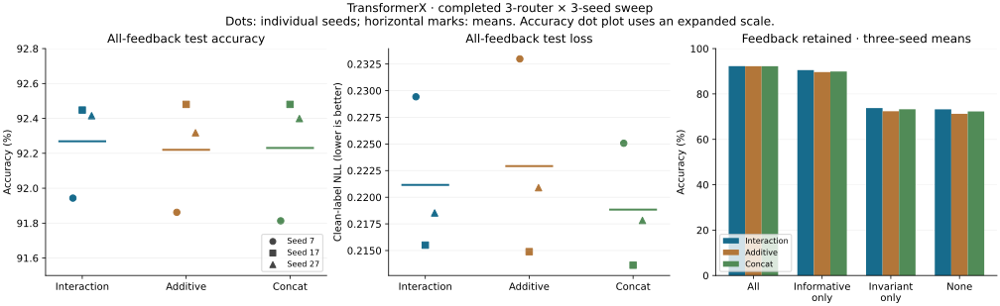

# Completed GPU sweep: useful state, no clear router accuracy winner

**30 October 2026 — all nine runs completed.** Interaction, additive and concat were each trained with seeds 7, 17 and 27 for 1,000 steps. Each was evaluated using its minimum-validation-NLL checkpoint. The source reports total **9.07 hours** of training and evaluation time; process startup and model loading may add to elapsed wall time.

**The repeated finding is useful persistent state. The extra interaction/additive router features do not deliver a clear accuracy gain over the simpler concat router on this task.** Concat achieves the lowest clean test NLL in each seed while using fewer trainable parameters.

## Main test results

All-feedback condition; clean answer accuracy. Each entry uses 6,144 trials in 64 episodes. Means give equal weight to the three seeds. SD is sample standard deviation across seeds, not a confidence interval.

| Router | Seed 7 | Seed 17 | Seed 27 | Mean ± SD | Mean clean NLL | Trainable parameters |
|---|---:|---:|---:|---:|---:|---:|
| Interaction | 91.94% | 92.45% | 92.42% | **92.27% ± 0.28 pp** | 0.22115 | 166,279 |
| Additive | 91.86% | 92.48% | 92.32% | **92.22% ± 0.32 pp** | 0.22292 | 166,279 |
| Concat | 91.81% | 92.48% | 92.40% | **92.23% ± 0.36 pp** | 0.21884 | 159,591 |

The same-stream uniform-rule marginal averages **80.46%**; the exact known-model Bayesian reference averages **92.89%**. These are three-seed means, not the earlier seed-7 values of 79.92% and 92.61%. The population marginal expectation is 80%; finite streams differ.

Interaction leads additive by only **0.049 percentage points** on average and concat by **0.038 points**. Across the 18,432 test predictions per router, those net differences are nine and seven answers, respectively. The scores are practically close; three seeds do not establish formal equivalence or a small statistically reliable advantage.

Concat has **6,688 fewer trainable parameters (4.02% fewer)** than either expanded router, and its NLL is lower in all three seeds:

| Seed | Interaction NLL | Additive NLL | Concat NLL |
|---|---:|---:|---:|
| 7 | 0.229429 | 0.232984 | 0.225068 |
| 17 | 0.215507 | 0.214891 | 0.213626 |
| 27 | 0.218527 | 0.220900 | 0.217824 |

This makes concat the economical reference for further work on this benchmark. The losses differ modestly; it is not a claim of universal superiority. Only interaction versus additive has exactly matched parameter count and initialization shapes; concat removes the extra projections and changes the parameter budget and initialization layout.

## State use survives replication

| Router | Normal mean accuracy | Read-disconnected mean | Mean read benefit |
|---|---:|---:|---:|
| Interaction | 92.27% | 80.17% | **+12.10 pp** |
| Additive | 92.22% | 80.65% | **+11.57 pp** |
| Concat | 92.23% | 80.17% | **+12.06 pp** |

Every individual run benefits from state access; the gains range from **+9.81 to +12.96 points**. Invariant-trial accuracy remains 100%, and restoration error is 0.0 for every router/seed/feedback condition. The intervention preserves the stored state and temporarily removes its influence on a query, with the normal trajectory continuing afterward.

Disconnection removes both state-dependent routing and the additive state readout. It therefore supports useful state access in the full model, not a unique causal role for the router. Reset and read-disconnected predictions coincide in these evaluations and are not independent confirmations.

Unlike seed 7, the disconnected model does not always exactly match the marginal reference in seeds 17 and 27. These are different stateless predictors: the learned models can choose different sides of the prior's ambiguous tone-three decision. On finite streams their accuracies differ. The audit confirms that all routers receive identical underlying streams within each seed; the different disconnected scores are not different datasets.

## Feedback ablations and their variability

Three-seed mean accuracy, with sample SD in percentage points:

| Feedback retained | Interaction | Additive | Concat |
|---|---:|---:|---:|
| All | 92.27% ± 0.28 | 92.22% ± 0.32 | 92.23% ± 0.36 |
| Informative only | 90.52% ± 1.19 | 89.63% ± 2.02 | 89.90% ± 1.15 |
| Invariant only | 73.79% ± 5.31 | 72.40% ± 3.97 | 73.26% ± 3.43 |
| None | 73.23% ± 5.44 | 71.25% ± 2.39 | 72.29% ± 4.75 |

The initial informative-only interaction advantage partially repeats: interaction minus additive is **+1.64, −0.02 and +1.04 points** in seeds 7, 17 and 27, averaging **+0.89 points**. Against concat, the differences are **−1.40, +3.08 and +0.18 points**. This is an exploratory robustness lead with substantial seed dependence, not an established ranking.

With informative evidence absent, all variants have poor mean fallback performance, and individual seeds vary markedly. Invariant-only and no-feedback mean scores are around 71–74%, below the 80.46% marginal reference. Not every individual run is below its finite-sample marginal, so the defensible claim is poor aggregate fallback, not universal degradation in every episode or seed.

Feedback masking substitutes an unseen-in-training `no feedback` marker. That distribution shift and recurrent dynamics are confounded here. The results justify studying missing-evidence handling; they do not isolate why it fails. The exact filter is unaffected by removing invariant feedback, but each learned variant degrades on average.

## Selection, scope and remaining questions

| Router | Selected step, seed 7 | Seed 17 | Seed 27 |
|---|---:|---:|---:|
| Interaction | 925 | 950 | 675 |
| Additive | 825 | 950 | 675 |
| Concat | 875 | 950 | 800 |

These were selected by validation NLL only; the final log line at step 1,000 is not the selected checkpoint's test score. All models have a frozen DistilGPT-2 backbone and a 64-scalar state (256 bytes in FP32 per stream). The seed changes both initialization and generated streams; the comparison pairs routers within each seed. There are three seed-level replicates, not thousands of independent training runs.

The three routers share the same nonlinear recurrent update and adapter bank. Concat is not a linear-memory system, and additive does not eliminate all multiplicative operations. This sweep tests whether additional router features help that shared architecture. It does not compare the loop against a GRU, recurrent tokens, a trained stateless transformer, or a history-window transformer; those controls remain unrun in this uploaded sweep.

The original frozen dictionary-language and occluded-motion runs remain near chance (**23.96%** and **24.74%**, respectively). The successful task is synthetic binary categorization from feedback, not language generation. No general context-rot fix, preservation of every pretrained capability, lifelong memory guarantee, or reproduction of a biological mechanism follows from it.

A sensible next experiment is to use concat as the simpler reference, compare the shared loop with the existing GRU/token/window controls, and separately test training with missing feedback. Those are proposed follow-ups, not results or changes included in this update. Because the present test streams have been inspected repeatedly, any tuning based on these findings should be confirmed on fresh held-out streams.

## Audit and source files

The [reproduction script](analyze_full_sweep_20261030.py) validates all nine checkpoints' selection metadata, matched settings, identical trial metadata within each seed, distinct streams across seeds, CSV-derived accuracy/NLL, and matching analytical references. It does not load checkpoints or retrain models.

- [Nine-run table](FULL_SWEEP_2026-10-30.csv).
- [Aggregate values, per-seed differences and SHA-256 source hashes](FULL_SWEEP_2026-10-30.json).
- Raw results under [runs/silent-routing](../runs/silent-routing), arranged by router and seed.
- Rebuild with `python results/analyze_full_sweep_20261030.py` (NumPy and Matplotlib required).
- Earlier [interaction snapshot](GPU_INTERIM_2026-10-30.md) and [seed-7 comparison](ROUTER_COMPARISON_2026-10-30.md) are retained as historical records.
