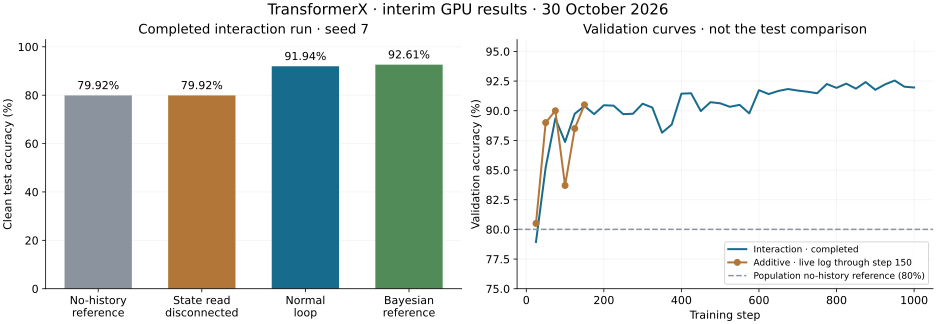

# First GPU results: useful state, multiplication still unproven

> Superseded by the [completed three-seed, three-router analysis](FULL_SWEEP_2026-10-30.md). This earlier snapshot is retained for provenance.

> Historical snapshot: additive has since completed. See the [completed seed-7 router comparison](ROUTER_COMPARISON_2026-10-30.md) for the current comparison; the provisional log and chart below are preserved as originally reported.

**Interim update, 30 October 2026.** Three completed runs are available: original language, original vision, and silent-rule interaction, all training seed 7. The additive silent-rule run is still in progress in the supplied log (through step 150); no completed additive or concat test result was available for this update.

**Finding:** the silent-rule controller uses persistent state to improve held-out decisions. That is a positive result for this trained system on this synthetic task. It does not establish an advantage over other recurrent controllers, a special benefit from multiplicative routing, or prevention of catastrophic forgetting.

## Completed test results

| Experiment | Selected step / completed steps | Clean test accuracy | Reference | Assessment |
|---|---:|---:|---:|---|
| Frozen DistilGPT-2, contextual dictionaries | 50 / 1,000 | 23.96% | 25% uniform-answer chance | No demonstrated learning |
| Frozen ViT, occluded object direction | 800 / 1,000 | 24.74% | 25% uniform-answer chance | No demonstrated learning |
| Frozen DistilGPT-2, silent rules, interaction router | 925 / 1,000 | **91.94%** | **79.92%** same-stream no-history marginal | Useful history dependence in this run |

The silent task has two answers and four hidden rules. Its no-history reference is 80% in expectation, not 25% or 50%. Reported reference values below use exactly the same test streams as the model.

The language result covers 1,536 queries in 128 episodes. Normal and shuffled-state accuracy are both 23.96%; reset is 25.00%. Vision covers 384 queries in 64 episodes; normal, reset and long-gap accuracy are all 24.74%. Vision state shuffling is unavailable at batch size 1. These runs do not show useful temporal memory. Their failure does not establish whether the bottleneck is representation, optimization, capacity, or task design.

## The strongest evidence: disconnect the read

The silent checkpoint was selected by lowest validation NLL at step 925 (validation accuracy 92.22%, NLL 0.2234). The later peak validation accuracy, 92.5% at step 950 in rounded logs, is not the selected checkpoint and is not the test result.

Test: 64 independent episodes, 96 trials each, 6,144 predictions per feedback condition. All weights remain fixed during evaluation.

| Predictor, with all feedback available | All trials | Rule-dependent trials | Rule-invariant trials | Clean NLL, all trials |
|---|---:|---:|---:|---:|
| Normal interaction loop | **91.94%** | **86.38%** | **100.00%** | 0.2294 |
| Read disconnected | 79.92% | 66.05% | 100.00% | 0.4011 |
| Fresh-state prediction | 79.92% | 66.05% | 100.00% | 0.4011 |
| Uniform-rule marginal reference | 79.92% | 66.05% | 100.00% | 0.3612 |
| Exact Bayesian reference | 92.61% | 87.51% | 100.00% | 0.1898 |

Removing access to history costs **12.03 percentage points overall** and **20.33 points on rule-dependent trials**, while invariant decisions remain intact. Restoring the unchanged state restores the original logits exactly: maximum recorded restoration error is 0.0 in every feedback condition.

This controlled intervention supports a causal contribution from the state-read pathways within this model. It disables both state-dependent adapter routing and the additive state readout, so it cannot identify which path earns the gain. It is a one-query paired intervention, not a prolonged lesion or recovery test. Fresh-state and disconnected predictions coincide here; they are not independent replications.

The learned model is **0.67 percentage points below** the known-model Bayesian reference in overall accuracy on these streams. The reference knows the thresholds, hazard and noise rate; it is not a matched learned baseline. The model trains on noisy feedback while the filter reports clean-label probabilities, so the clean NLL/Brier gap also includes a calibration difference.

A paired bootstrap resampling all 96 trials together within each of the 64 episodes gives a 95% percentile interval of **+10.17 to +13.87 percentage points** for normal minus disconnected accuracy (10,000 resamples, fixed seed). This describes test-episode uncertainty conditional on **one trained checkpoint**; it does not measure variation across training seeds or prove architectural superiority.

## Feedback matters—and fallback is not robust

| Feedback supplied to the continuing loop | All-trial accuracy | Rule-dependent accuracy | Rule-invariant accuracy | Bayesian reference, all trials |
|---|---:|---:|---:|---:|
| All feedback | 91.94% | 86.38% | 100.00% | 92.61% |
| Informative feedback only | 89.71% | 82.61% | 100.00% | 92.61% |
| Invariant feedback only | 70.82% | 50.67% | 100.00% | 79.92% |
| No feedback | 70.59% | 50.29% | 100.00% | 79.92% |

Keeping informative evidence preserves most of the benefit. Withholding it removes the benefit. But the active loop without informative evidence performs **worse** than simply disconnecting it, not merely at the marginal reference.

The exact filter is unaffected by removing invariant feedback, because those observations carry no rule likelihood-ratio evidence. The learned model loses 2.23 points when they are removed. This prevents a claim that it has learned an exact Bayesian update or perfectly selective writes. Withheld events are replaced by an unseen-in-training `no feedback` marker; distribution shift and altered state dynamics are plausible contributors. These results do not isolate their causes, and they do not prove invariant feedback itself carries hidden rule information.

## Adaptation after genuine switches

The standard JSON age bins include episode initialization. The table below is recomputed from the trial CSV and **excludes every initial segment**, retaining only trials after at least one actual switch. Age 0 is the first prediction under a new hidden rule, before its feedback.

| Trial age after switch | Trial count | Loop | Bayesian reference | Read disconnected |
|---|---:|---:|---:|---:|
| 0 | 293 | 67.92% | 68.26% | 79.18% |
| 1 | 273 | 78.39% | 76.56% | 78.39% |
| 2 | 263 | 82.51% | 80.23% | 76.81% |
| 3 | 240 | 88.33% | 88.33% | 76.67% |
| 4 | 219 | 90.41% | 90.87% | 76.26% |
| 5–9 | 947 | 93.03% | 93.35% | 79.62% |
| 10+ | 2,543 | 95.75% | 97.29% | 81.01% |

The loop initially carries an outdated belief and then recovers over several trials. That is expected under an unannounced switch; even the Bayesian filter initially suffers. These are pooled descriptive age bins, with different surviving segments in later bins, not a precise per-switch recovery-time estimate.

Returning-rule segments score 91.06% (Bayes 91.74%, marginal 79.67%). That supports performance on revisited regimes, but does not distinguish recall of a stored old rule from re-inference using new feedback, and is not a lifelong-forgetting test.

## Does multiplication earn its place?

The only completed silent-rule run uses the interaction router. Additive figures below are transcribed from the user's live console output, not invented test scores or a completed result file. Interaction values are from its committed validation CSV, rounded to match the console.

| Training step | Interaction val accuracy | Additive val accuracy | Interaction val NLL | Additive val NLL |
|---|---:|---:|---:|---:|
| 25 | 78.9% | 80.5% | 0.4249 | 0.3902 |
| 50 | 85.2% | 89.0% | 0.3482 | 0.2827 |
| 75 | 89.4% | 90.0% | 0.2656 | 0.2612 |
| 100 | 87.4% | 83.7% | 0.3022 | 0.3739 |
| 125 | 89.7% | 88.5% | 0.2774 | 0.2820 |
| 150 | 90.4% | 90.5% | 0.2519 | 0.2545 |

The early trajectories are similar and fluctuate. There is no consistent early winner. The additive router retains the same nonlinear recurrent update and adapter bank; it is not a linear-memory control. The pending comparison isolates the router interaction term, not all nonlinear or multiplicative computation in the system.

The next decisive evidence is the completed additive/concat held-out scores and interventions, followed by paired training seeds 17 and 27. GRU, token-memory and window controls remain necessary for broader architecture comparisons. A synthetic classification gain is not yet an improvement in general language generation or visual understanding.

## Provenance and reproduction

- [Language result](../runs/language-gpu/results.json), [validation log](../runs/language-gpu/validation.csv).
- [Vision result](../runs/vision-gpu/results.json), [validation log](../runs/vision-gpu/validation.csv).
- [Silent interaction result](../runs/silent-routing/loop-interaction/seed-7/results.json), [trial CSV](../runs/silent-routing/loop-interaction/seed-7/trials.csv), [validation log](../runs/silent-routing/loop-interaction/seed-7/validation.csv).
- [Derived audit with source hashes](GPU_INTERIM_2026-10-30.json) and [reproduction script](analyze_gpu_20261030.py). Run `python results/analyze_gpu_20261030.py` with NumPy and Matplotlib installed. The script checks test accuracy and NLL against the trial CSV and rebuilds the figure and bootstrap summary without loading models or retraining.

The uploaded artifacts report an NVIDIA GeForce RTX 3060, PyTorch 2.7.1+cu118. The silent run has 166,279 trainable parameters, a 64-scalar persistent state (256 bytes in FP32 per stream), and took approximately 60.8 minutes including evaluation. The default HF language model resolves to DistilGPT-2; its backbone is frozen. Additive completion and any later uploads are outside this snapshot.
